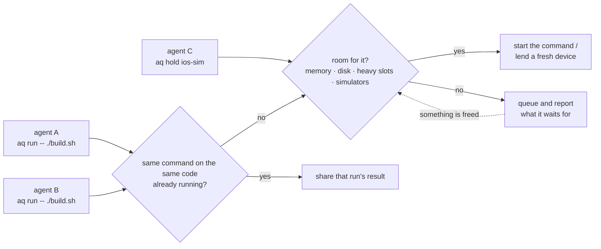

<div align="center">


# aq

**A local queue and device lender for parallel AI agent sessions on one Mac.**

Builds take turns instead of swapping the machine to death, identical builds run once,<br>
and simulators, devices and test accounts go to one agent at a time.

[](https://github.com/xiatiandeairen/agent-quay/releases)
[](#license)
[](#requirements)
[](Cargo.toml)
[](#install)
[](#claude-code-plugin)

English · [简体中文](README.zh-CN.md)

[Quick start](#quick-start) · [Usage](#usage) · [How it works](#how-it-works) · [FAQ](#faq) · [Design notes](docs/design.md)

</div>

<br>


<sub>Real aq calls; `build.sh` and `test.sh` stand in for heavy builds, and idle waits are cut.</sub>

<sub>With narration (sound on):</sub>

https://github.com/user-attachments/assets/b9057d66-9390-4473-adc3-c4de9297026e

## Contents

- [Why aq](#why-aq)
- [Features](#features)
- [Quick start](#quick-start)
- [Install](#install)
- [Usage](#usage)
- [Configuration](#configuration)
- [How it works](#how-it-works)
- [What aq runs](#what-aq-runs)
- [Privacy](#privacy)
- [FAQ](#faq)
- [Contributing](#contributing)
- [License](#license)

## Why aq

When several agent sessions (Claude Code, Codex, …) work on the same machine, each one decides on its own to build, test or boot a simulator. They pile up, the Mac thrashes, and simulators and test accounts get overwritten by each other. `aq` is a single command the agents call instead:

| Problem | What aq does |
| --- | --- |
| Several builds at once swap the machine to death | Admits heavy tasks by free memory and disk, at most 2 at a time by default; holds everything that needs memory while macOS reports memory pressure |
| Agents fight over the same simulator, device or test account | Lends each one to a single session; simulators are fresh copies, deleted on return, booted one at a time, at most one per 8 GB of RAM by default |
| The same code and command run twice | A run already in progress is shared; both callers get its result |
| Agents poll in loops waiting for results | One command waits and returns a structured status |

aq is opt-in: it schedules only what agents submit through it and never blocks other commands.

## Features

- **No manifests to write.** Each command's CPU, memory and disk needs are measured from its past runs in the same repository.
- **Shared runs.** The same command on the same code (as git sees it) runs once; every caller gets the result. Pass `--fresh` to opt out.
- **Fresh devices per borrow.** iOS simulators and Android emulators are created for each hold and deleted on return; browser sessions too.
- **Your phone stays yours.** Real devices are lent only if you list them in the config.
- **Self-cleaning.** Devices whose borrower is gone or idle are reclaimed; a crashed runner never leaves a half-started command behind.
- **Built for agents.** One JSON line per object, a ready-to-run `next` command while waiting, and exit codes grouped by what the caller should do next.
- **No daemon.** Every `aq` process works on one SQLite ledger; there is nothing to keep running.
- **Live dashboard.** `aq status --top` shows CPU, memory, disk, heavy slots, tasks and holds, like `htop`.

## Quick start

```bash
# 1. Install the aq command
brew install xiatiandeairen/tap/aq
```

```text
# 2. In Claude Code, add the plugin so every session knows when to call aq
/plugin marketplace add xiatiandeairen/agent-quay
/plugin install agent-quay@agent-quay
```

That's it: agents now run `aq run -- <build or test>` and `aq hold ios-sim` instead of calling `xcodebuild` or `simctl` directly. To watch them, run `aq status --top` in a spare terminal.

For other agents, point them at [`skills/aq/SKILL.md`](skills/aq/SKILL.md), for example by referencing it from your `AGENTS.md`.

## Install

### Requirements

- macOS (tested on Apple Silicon)
- Xcode for `ios-sim`; Android SDK emulator for `android-emu` (optional)
- `agent-browser` / `agent-desktop` only if you lend `browser` / `desktop` sessions

### Homebrew

```bash
brew install xiatiandeairen/tap/aq
```

### From source

Rust 1.89 or later:

```bash
cargo install --git https://github.com/xiatiandeairen/agent-quay --locked
```

### Claude Code plugin

The plugin gives every session the `aq` skill, so agents know when and how to use it, and tells the agent how to install `aq` if it is missing.

```text
/plugin marketplace add xiatiandeairen/agent-quay
/plugin install agent-quay@agent-quay
```

What the plugin contains:

- The `aq` skill (`skills/aq/SKILL.md`): instructions that tell the agent when and how to call `aq`. It runs nothing by itself.
- A SessionStart hook (`hooks/session-start.sh`): checks whether `aq` is on `PATH`. If it is missing, it adds one line to the session context asking the agent to tell the user to run `brew install xiatiandeairen/tap/aq`. It does not install anything, change any setting or use the network.

The plugin does not ship the `aq` binary or any MCP server. Install `aq` separately as shown above.

## Usage

```bash
aq run -- xcodebuild -scheme App -destination 'generic/platform=iOS Simulator' build
aq status <id> --wait 60            # keep waiting on a queued or running task
aq hold ios-sim --account alice     # borrow a fresh simulator plus a test account
aq release <hold-id>                # give them back
aq cancel <id>                      # drop a queued or running task
aq status --human                   # everything on this machine, readable
aq status --top                     # live dashboard, like htop (Ctrl-C to quit)
```

Device types for `hold`: `ios-sim`, `android-emu`, `ios-device`, `android-device`, `browser`, `desktop`. Repeat a type to borrow several; the whole set is lent at once or queued as one.

### Output

Each command prints one JSON line per object; act on its `status` (`queued`, `running`, `ok`, `failed`, `held`, `rejected`, …). Two agents submitting the same build, then a third submitting the tests (ids and paths shortened):

```console
$ aq run --wait 0 -- ./build.sh
{"id":"ex_01m7znrb5p…","status":"queued","next":"aq status ex_01m7znrb5p… --wait 60"}
$ aq run --wait 0 -- ./build.sh
{"id":"ex_01m7znrb5p…","status":"running","reused":true,"next":"aq status ex_01m7znrb5p… --wait 100","log":"…/aq/logs/ex_01m7znrb5p….log"}
$ aq run --wait 0 -- ./test.sh
{"id":"ex_01m7znrb7z…","status":"queued","next":"aq status ex_01m7znrb7z… --wait 100"}
```

`--human` adds the details: what a task waits for and where its estimate came from.

```console
$ aq status --human
tasks      running 1   queued 1
resources  CPU 40%   mem 33%   disk 92%   phones 0%   simulators 0
ex_01m7znrb5p…  running     ./build.sh
    booked heavy true mem 11MB disk 0MB download false  timeout 1800s  estimate from measurements
    running 1s  process group 41827 alive  runner alive
ex_01m7znrb7z…  queued      ./test.sh
    booked heavy true mem 11MB disk 0MB download false  timeout 1800s  estimate from measurements
    queued 1s  waiting for heavy slot  runner alive
```

### Exit codes

Grouped by what the caller should do next. When several ids are queried together, the one that needs the most attention wins.

| Code | Meaning | Next step |
| --- | --- | --- |
| 0 | Done | Continue |
| 1 | The command failed | Read `log` and fix the code |
| 2 | Not finished yet | Run the `next` command to keep waiting |
| 3 | Wrong usage | Fix the call |
| 4 | Retryable | Submit or borrow again as is |
| 5 | Needs a human | Pass `message` on to the user |

## Configuration

Optional. `~/.config/aq/config.toml` (or `$XDG_CONFIG_HOME/aq/config.toml`):

```toml
heavy_slots = 2          # heavy tasks at the same time
mem = "28G"              # memory aq may hand out; default 3/4 of RAM
sim_slots = 4            # iOS simulators + Android emulators at once; default one per 8 GB of RAM
disk_floor = "50G"       # keep at least this much disk free
nice = 10                # CPU priority of everything aq starts (0-20, 0 = off)
ai_cli = "auto"          # or a fixed command, e.g. "claude -p"

[ios-sim]
model = "iPhone 17 Pro"

[ios-device]
ids = ["00008150-…"]     # only devices listed here are ever lent
```

## How it works



- No daemon: every `aq` process works on one SQLite ledger under `~/.local/state/aq/`.
- Resource needs come from past runs of the same command in the same repository. A command seen for the first time starts right away as a light task and is reclassified as heavy while it runs if it turns out to be; if the calling agent is on the verified list (currently Claude Code and Codex), aq also asks that agent's own CLI for an estimate in the background for later reference.
- "Same code" means what git can see: changes to tracked files, untracked files that are not ignored, and registered submodules.
- A borrowed device that is not returned is reclaimed automatically; the rules are in the code; [design.md 3.3](docs/design.md#33-设备与回收) explains why.

## What aq runs

aq only runs what an agent asks it to:

- `aq run`: the given command, in its own process session, once there is room for it.
- Code fingerprint: read-only `git` commands (`rev-parse`, `diff HEAD`, `ls-files`, `submodule status`) in the working directory, so identical runs can be shared.
- `aq hold`: `xcrun simctl` to create, boot and delete simulators; the Android SDK `emulator` and `adb` for emulators; read-only `xcrun devicectl list devices` and `adb devices -l` to find real devices; `agent-browser` to open and close browser sessions. A `desktop` hold only hands out a session name.
- First run of a new command: the calling agent's CLI, for an estimate (see [Privacy](#privacy)).

## Privacy

aq runs locally and does not send telemetry. The only outbound traffic is the first-time estimate above: aq runs the agent's CLI (e.g. `claude -p`) with the normalized command line, the working directory path, file counts and sizes by extension of the repository, and the machine's memory capacity, under that CLI's own account and data policy. Set `ai_cli` to a fixed command, or use an agent outside the verified list, to change or avoid this.

## FAQ

<details>
<summary><b>Does aq intercept commands my agents run directly?</b></summary>

No. aq only schedules what is submitted through `aq run` and `aq hold`. Anything else runs as usual; aq only counts the memory and disk it uses when deciding what to admit next.
</details>

<details>
<summary><b>Does it work on Linux or Windows?</b></summary>

No. aq reads processes through macOS `libproc` and manages simulators with `simctl`, so it runs on macOS only.
</details>

<details>
<summary><b>Two runs share a result but my environment variables differ. Why?</b></summary>

"Same code" is decided by what git can see. Environment variables, ignored files, scripts outside the repository and build caches are not part of it. Pass `--fresh` when a run must not be shared.
</details>

<details>
<summary><b>What happens if an agent forgets to release a device?</b></summary>

aq reclaims it when the borrower's process is gone, when the device sits idle, or when the hold passes the lending limit, and reports it as `reclaimed`. That is a safety net; agents should still call `aq release`.
</details>

<details>
<summary><b>Will aq lend the iPhone I use every day?</b></summary>

Only if you list it under `[ios-device] ids` in the config. Connected devices that are not listed are never lent; aq shows a config snippet so you can decide.
</details>

<details>
<summary><b>Where are the logs and state?</b></summary>

Under `~/.local/state/aq/` (or `$XDG_STATE_HOME/aq/`). Each `aq run` result includes the path of its log, and `aq status --human` prints the config and state directories in use.
</details>

## Contributing

Issues and pull requests are welcome. Before sending a change:

- Run `just check`: format, clippy, tests, size limits and the case table must all pass.
- Add new behavior to [`docs/cases.md`](docs/cases.md) first, then tag the test that guards it with its `CASE-*` id.
- Read [`docs/design.md`](docs/design.md) for the scope (what aq does and does not own) and why each mechanism is the way it is.

## License

Licensed under either of [Apache License, Version 2.0](LICENSE-APACHE) or [MIT license](LICENSE-MIT) at your option.
