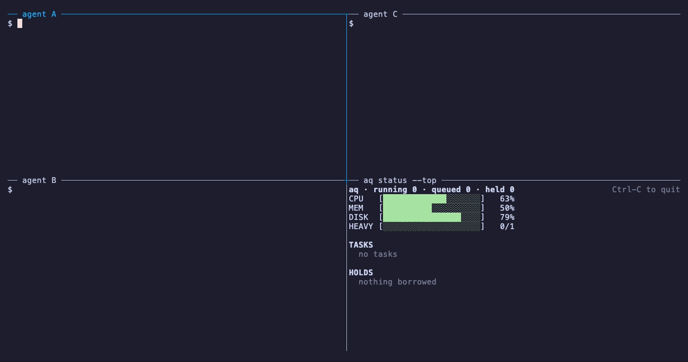

# aq (agent-quay)

English · [简体中文](README.zh-CN.md)

A local queue and device lender for parallel AI agent sessions on one Mac.



<sub>Real aq calls; `build.sh` and `test.sh` stand in for heavy builds. The ~40 s spent creating the simulators is cut. Re-record with `docs/demo/record.sh`.</sub>

When several agent sessions (Claude Code, Codex, …) work on the same machine, each one decides on its own to build, test or boot a simulator. They pile up, the Mac thrashes, and simulators and test accounts get overwritten by each other. `aq` is a single command the agents call instead:

| Problem | What aq does |
| --- | --- |
| Several builds at once swap the machine to death | Admits heavy tasks by free memory and disk, at most 2 at a time by default |
| Agents fight over the same simulator, device or test account | Lends each one to a single session; simulators are fresh copies, deleted on return |
| The same code and command run twice | A run already in progress is shared; both callers get its result |
| Agents poll in loops waiting for results | One command waits and returns a structured status |

aq is opt-in: it schedules only what agents submit through it and never blocks other commands.

## Requirements

- macOS (tested on Apple Silicon)
- Xcode for `ios-sim`; Android SDK emulator for `android-emu` (optional)
- `agent-browser` / `agent-desktop` only if you lend `browser` / `desktop` sessions

## Install

```bash
brew install xiatiandeairen/tap/aq
```

From source (Rust 1.89+):

```bash
cargo install --git https://github.com/xiatiandeairen/agent-quay --locked
```

### Claude Code plugin

The plugin gives every session the `aq` skill, so agents know when and how to use it, and tells the agent how to install `aq` if it is missing.

```text
/plugin marketplace add xiatiandeairen/agent-quay
/plugin install agent-quay@agent-quay
```

What the plugin contains:

- The `aq` skill (`skills/aq/SKILL.md`): instructions that tell the agent when and how to call `aq`. It runs nothing by itself.
- A SessionStart hook (`scripts/session-start.sh`): checks whether `aq` is on `PATH`. If it is missing, it adds one line to the session context asking the agent to tell the user to run `brew install xiatiandeairen/tap/aq`. It does not install anything, change any setting or use the network.

The plugin does not ship the `aq` binary or any MCP server. Install `aq` separately as shown above.

## Usage

```bash
aq run -- xcodebuild -scheme App -destination 'generic/platform=iOS Simulator' build
aq status <id> --wait 60            # keep waiting on a queued or running task
aq hold ios-sim --account alice     # borrow a fresh simulator plus a test account
aq release <hold-id>                # give them back
aq status --human                   # everything on this machine, readable
aq status --top                     # live dashboard, like htop (Ctrl-C to quit)
```

Each command prints one JSON line per object; act on its `status` (`queued`, `running`, `ok`, `failed`, `held`, `rejected`, …). `--human` adds the details: what a task waits for and where its estimate came from.

Device types for `hold`: `ios-sim`, `android-emu`, `ios-device`, `android-device`, `browser`, `desktop`.

## Configuration

Optional. `~/.config/aq/config.toml` (or `$XDG_CONFIG_HOME/aq/config.toml`):

```toml
heavy_slots = 2          # heavy tasks at the same time
mem = "28G"              # memory aq may hand out
disk_floor = "50G"       # keep at least this much disk free
ai_cli = "auto"          # or a fixed command, e.g. "claude -p"

[ios-sim]
model = "iPhone 17 Pro"

[ios-device]
ids = ["00008150-…"]     # only devices listed here are ever lent
```

## How it works

- No daemon: every `aq` process works on one SQLite ledger under `~/.local/state/aq/`.
- Resource needs come from past runs of the same command in the same repository. A command seen for the first time starts right away as a light task and is reclassified as heavy while it runs if it turns out to be; if the calling agent is on the verified list (currently Claude Code and Codex), aq also asks that agent's own CLI for an estimate in the background for later reference.
- A borrowed device is reclaimed when the borrowing agent session exits, or after 2 hours idle when the session cannot be identified.

## What aq runs

aq only runs what an agent asks it to:

- `aq run`: the given command, in its own process session, once there is room for it.
- Code fingerprint: read-only `git` commands (`rev-parse`, `diff HEAD`, `ls-files`, `submodule status`) in the working directory, so identical runs can be shared.
- `aq hold`: `xcrun simctl` to create, boot and delete simulators; the Android SDK `emulator` and `adb` for emulators; read-only `xcrun devicectl list devices` and `adb devices -l` to find real devices; `agent-browser` to open and close browser sessions. A `desktop` hold only hands out a session name.
- First run of a new command: the calling agent's CLI, for an estimate (see Privacy).

## Privacy

aq runs locally and does not send telemetry. The only outbound traffic is the first-time estimate above: aq runs the agent's CLI (e.g. `claude -p`) with the normalized command line, the working directory path, file counts and sizes by extension of the repository, and the machine's memory capacity, under that CLI's own account and data policy. Set `ai_cli` to a fixed command, or use an agent outside the verified list, to change or avoid this.

## License

Licensed under either of [Apache License, Version 2.0](LICENSE-APACHE) or [MIT license](LICENSE-MIT) at your option.
