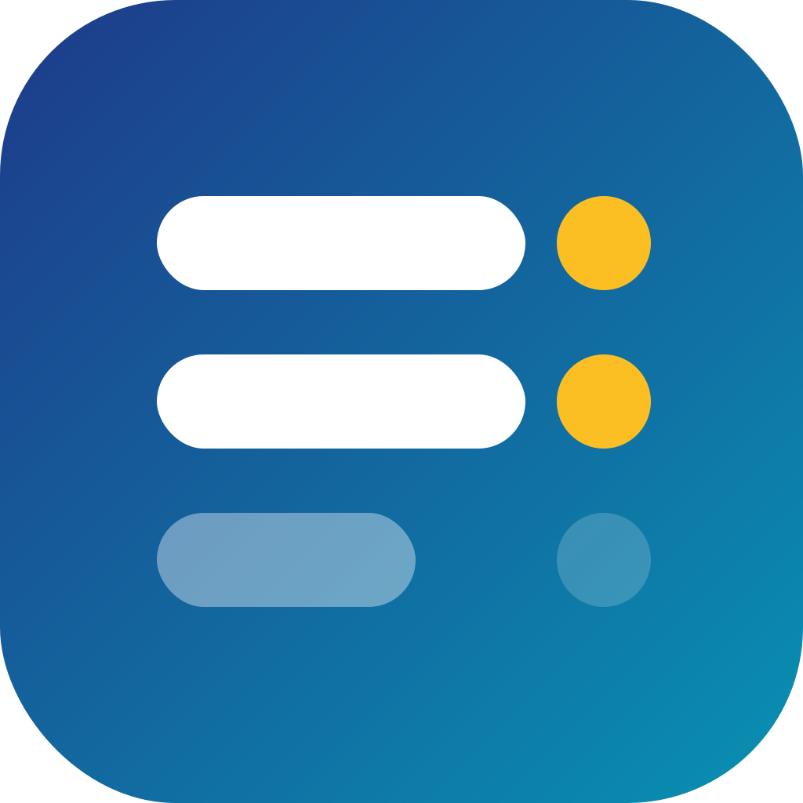
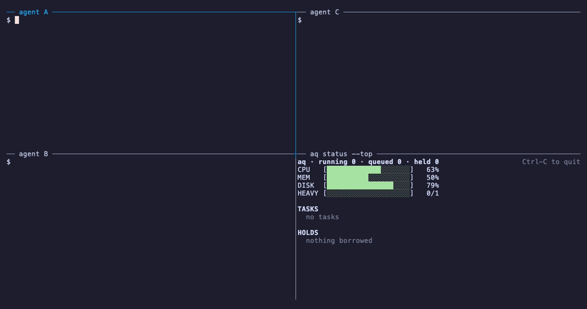
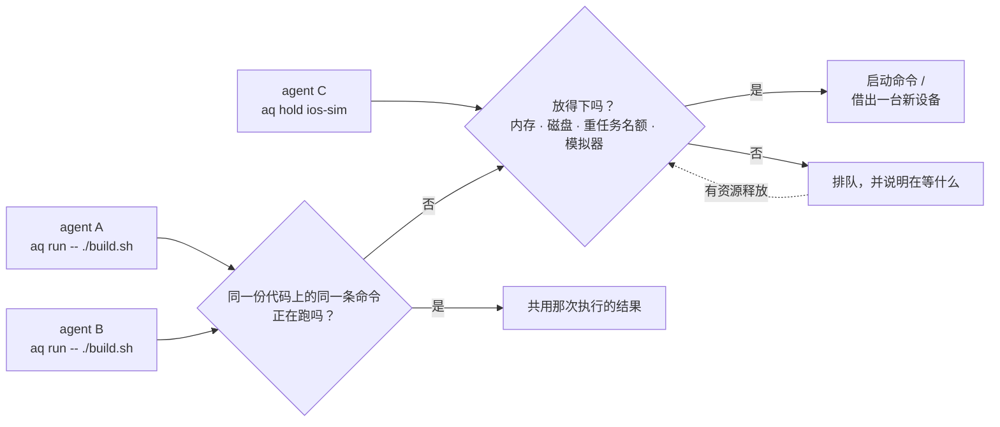

<div align="center">



# aq

**给同一台 Mac 上并行工作的多个 AI agent 会话用的本机排队和设备借还工具。**

编译轮流跑，不再把机器拖进内存换页；相同的编译只跑一次；<br>
模拟器、真机和测试账号一次只借给一个 agent。

[](https://github.com/xiatiandeairen/agent-quay/releases)
[](#许可证)
[](#环境要求)
[](Cargo.toml)
[](#安装)
[](#claude-code-插件)

[English](README.md) · 简体中文

[快速开始](#快速开始) · [用法](#用法) · [原理](#原理) · [常见问题](#常见问题) · [设计依据](docs/design.md)

</div>

<br>



<sub>aq 调用都是真实的，`build.sh` 和 `test.sh` 代替重型编译；等待创建模拟器的时间和几秒空闲已剪掉。用 `docs/demo/record.sh` 可重录。</sub>

## 目录

- [为什么需要 aq](#为什么需要-aq)
- [特性](#特性)
- [快速开始](#快速开始)
- [安装](#安装)
- [用法](#用法)
- [配置](#配置)
- [原理](#原理)
- [aq 会运行什么](#aq-会运行什么)
- [隐私](#隐私)
- [常见问题](#常见问题)
- [参与开发](#参与开发)
- [许可证](#许可证)

## 为什么需要 aq

多个 agent 会话（Claude Code、Codex 等）在同一台机器上干活时，各自决定什么时候编译、跑测试、开模拟器，结果一起挤上来，机器被拖垮，模拟器和测试账号互相覆盖。`aq` 是 agent 改用的一条命令：

| 问题 | aq 怎么做 |
| --- | --- |
| 几个编译同时跑，内存换页拖垮机器 | 按剩余内存和磁盘放行重任务，默认同时最多 2 个；macOS 报内存压力时，要内存的一律先排队 |
| 抢同一台模拟器、真机或测试账号 | 一次只借给一个会话；模拟器每次新建、一台一台启动、归还即删，默认每 8G 内存最多一台 |
| 同一份代码、同一条命令跑两遍 | 正在跑的直接共用，两边拿到同一个结果 |
| agent 写循环反复查结果 | 一条命令等结果，返回结构化状态 |

aq 按需使用：只调度经它提交的任务，不拦截任何其他命令。

## 特性

- **不用申报资源。** 每条命令要多少 CPU、内存、磁盘，按它在同一仓库里的历史实测来估。
- **重复执行合并。** 同一份代码（按 git 看得到的内容）上的同一条命令只跑一次，所有调用方拿到同一个结果；要单独跑加 `--fresh`。
- **每次借都是新设备。** iOS 模拟器和 Android 模拟器每次借用时新建、归还即删，浏览器会话也一样。
- **自用手机不会被借走。** 真机只借配置里登记过的。
- **自动收尾。** 借用者已退出或闲置的设备会被收回；runner 崩溃不会留下执行到一半的命令。
- **为 agent 设计。** 每个对象一行 JSON；等待时直接给出下一条可执行的 `next` 命令；退出码按调用方下一步该做什么分组。
- **没有常驻服务。** 所有 `aq` 进程共用一个 SQLite 账本，不需要维护后台进程。
- **实时仪表盘。** `aq status --top` 像 `htop` 一样显示 CPU、内存、磁盘、重任务名额、任务和借用。

## 快速开始

```bash
# 1. 安装 aq 命令
brew install xiatiandeairen/tap/aq
```

```text
# 2. 在 Claude Code 里装插件，让每个会话知道什么时候该用 aq
/plugin marketplace add xiatiandeairen/agent-quay
/plugin install agent-quay@agent-quay
```

完成后，agent 会用 `aq run -- <编译或测试>`、`aq hold ios-sim` 代替直接调用 `xcodebuild`、`simctl`。想看它们在干什么，另开一个终端运行 `aq status --top`。

其他 agent 请把 [`skills/aq/SKILL.md`](skills/aq/SKILL.md) 交给它，例如在 `AGENTS.md` 里引用这个文件。

## 安装

### 环境要求

- macOS（在 Apple Silicon 上测试过）
- 借 `ios-sim` 需要 Xcode；借 `android-emu` 需要 Android SDK 模拟器（可选）
- 借 `browser` / `desktop` 时才需要 `agent-browser` / `agent-desktop`

### Homebrew

```bash
brew install xiatiandeairen/tap/aq
```

### 从源码安装

需要 Rust 1.89 及以上：

```bash
cargo install --git https://github.com/xiatiandeairen/agent-quay --locked
```

### Claude Code 插件

插件给每个会话加上 `aq` skill，让 agent 知道什么时候用、怎么用；本机没装 `aq` 时会告诉 agent 怎么装。

```text
/plugin marketplace add xiatiandeairen/agent-quay
/plugin install agent-quay@agent-quay
```

插件包含：

- `aq` skill（`skills/aq/SKILL.md`）：告诉 agent 什么时候、怎么调用 `aq` 的说明，本身不运行任何东西。
- 一个 SessionStart hook（`scripts/session-start.sh`）：检查 `PATH` 里有没有 `aq`；没有时往会话上下文加一行，让 agent 提醒用户运行 `brew install xiatiandeairen/tap/aq`。不安装任何东西，不改设置，不联网。

插件不带 `aq` 程序本身，也没有 MCP server，`aq` 按上面的方式另装。

## 用法

```bash
aq run -- xcodebuild -scheme App -destination 'generic/platform=iOS Simulator' build
aq status <id> --wait 60            # 接着等排队中或运行中的任务
aq hold ios-sim --account alice     # 借一台新模拟器和一个测试账号
aq release <借用id>                 # 归还
aq cancel <id>                      # 撤销排队中或运行中的任务
aq status --human                   # 全机情况，给人看
aq status --top                     # 实时仪表盘，类似 htop（Ctrl-C 退出）
```

`hold` 的设备类型：`ios-sim`、`android-emu`、`ios-device`、`android-device`、`browser`、`desktop`。要几台就把类型写几次；整组一次借到，或整组排队。

### 输出

每条命令每个对象输出一行 JSON，按 `status`（`queued`、`running`、`ok`、`failed`、`held`、`rejected` 等）决定下一步。下面是两个 agent 提交同一个编译、第三个提交测试时的输出（id 和路径已缩短）：

```console
$ aq run --wait 0 -- ./build.sh
{"id":"ex_01m7znrb5p…","status":"queued","next":"aq status ex_01m7znrb5p… --wait 60"}
$ aq run --wait 0 -- ./build.sh
{"id":"ex_01m7znrb5p…","status":"running","reused":true,"next":"aq status ex_01m7znrb5p… --wait 100","log":"…/aq/logs/ex_01m7znrb5p….log"}
$ aq run --wait 0 -- ./test.sh
{"id":"ex_01m7znrb7z…","status":"queued","next":"aq status ex_01m7znrb7z… --wait 100"}
```

加 `--human` 看细节：任务在等什么、资源估算从哪来。

```console
$ aq status --human
tasks      running 1   queued 1
resources  CPU 40%   mem 33%   disk 92%   phones 0%   simulators 0
ex_01m7znrb5p…  running     ./build.sh
    booked heavy true mem 11MB disk 0MB download false  timeout 1800s  estimate from measurements
    running 1s  process group 41827 alive  runner alive
ex_01m7znrb7z…  queued      ./test.sh
    booked heavy true mem 11MB disk 0MB download false  timeout 1800s  estimate from measurements
    queued 1s  waiting for heavy slot  runner alive
```

### 退出码

按调用方下一步该做什么分组。多个 id 一起查时，取最需要处理的那个。

| 码 | 含义 | 下一步 |
| --- | --- | --- |
| 0 | 完成 | 继续 |
| 1 | 命令失败 | 读 `log` 修代码 |
| 2 | 还没完 | 运行 `next` 命令接着等 |
| 3 | 写法错 | 改调用 |
| 4 | 可重试 | 原样重新提交或重新借 |
| 5 | 需要人 | 把 `message` 转告用户 |

## 配置

可选。`~/.config/aq/config.toml`（或 `$XDG_CONFIG_HOME/aq/config.toml`）：

```toml
heavy_slots = 2          # 同时最多几个重任务
mem = "28G"              # aq 可分配的内存；不写时取物理内存的 3/4
sim_slots = 4            # iOS 模拟器加 Android 实例最多几台；不写时每 8G 内存一台
disk_floor = "50G"       # 磁盘至少保留这么多
nice = 10                # aq 启动的进程的 CPU 优先级（0～20，0 不降）
ai_cli = "auto"          # 或写死一条命令，如 "claude -p"

[ios-sim]
model = "iPhone 17 Pro"

[ios-device]
ids = ["00008150-…"]     # 只借这里登记的真机
```

## 原理



- 没有常驻服务：所有 `aq` 进程共用 `~/.local/state/aq/` 下的一个 SQLite 账本。
- 资源需求来自同一仓库里同一条命令的历史实测。第一次遇到的命令不等评估，按轻任务立即放行，真跑重了再在运行中改记为重任务；如果调用方 agent 在已验证名单里（目前是 Claude Code 和 Codex），aq 同时在后台请它自己的 CLI 估一次留作参考。
- 「同一份代码」指 git 看得到的内容：已跟踪文件的改动、未忽略的新文件、登记过的子模块。
- 借出的设备没还时会自动收回，规则以代码为准，为什么这样定见 [design.md 3.3](docs/design.md#33-设备与回收)。

## aq 会运行什么

aq 只运行 agent 让它运行的东西：

- `aq run`：轮到时在独立的进程会话里运行给定的命令。
- 代码指纹：在执行目录运行只读的 `git` 命令（`rev-parse`、`diff HEAD`、`ls-files`、`submodule status`），用来判断能不能共用同一次执行。
- `aq hold`：用 `xcrun simctl` 新建、启动、删除模拟器；用 Android SDK 的 `emulator` 和 `adb` 管理安卓模拟器；用只读的 `xcrun devicectl list devices` 和 `adb devices -l` 查找真机；用 `agent-browser` 开关浏览器会话。借 `desktop` 只发一个会话名。
- 第一次遇到某条命令：调用 agent 自己的 CLI 估算资源（见[隐私](#隐私)）。

## 隐私

aq 在本机运行，不上报任何数据。唯一的对外请求是上面说的首次评估：aq 用 agent 自己的 CLI（如 `claude -p`）发送归一化后的命令、执行目录路径、仓库按扩展名统计的文件数量和大小，以及本机内存容量，走该 CLI 自己的账号和数据政策。把 `ai_cli` 写成固定命令，或使用不在已验证名单里的 agent，可以改变或避免这一点。

## 常见问题

<details>
<summary><b>agent 直接运行的命令会被 aq 拦下吗？</b></summary>

不会。aq 只调度经 `aq run`、`aq hold` 提交的任务，其他命令照常运行；aq 只在决定下一个放行谁时，把它们占用的内存和磁盘计入余量。
</details>

<details>
<summary><b>能在 Linux 或 Windows 上用吗？</b></summary>

不能。aq 用 macOS 的 `libproc` 读进程、用 `simctl` 管模拟器，只能在 macOS 上运行。
</details>

<details>
<summary><b>两次执行的环境变量不同，为什么还是共用了结果？</b></summary>

「同一份代码」按 git 看得到的内容判断，环境变量、被忽略的文件、仓库外的脚本和构建缓存都不算在内。不能共用时加 `--fresh`。
</details>

<details>
<summary><b>agent 忘了归还设备会怎样？</b></summary>

借用者的进程已经退出、设备闲置太久、或借出超过上限时，aq 会收回并报告为 `reclaimed`。这只是兜底，agent 仍然应该调用 `aq release`。
</details>

<details>
<summary><b>aq 会把我自己天天用的 iPhone 借出去吗？</b></summary>

只有在配置的 `[ios-device] ids` 里登记过才会。已连接但没登记的真机永远不借，aq 会给出一段配置片段，由你决定登不登记。
</details>

<details>
<summary><b>日志和状态存在哪？</b></summary>

在 `~/.local/state/aq/`（或 `$XDG_STATE_HOME/aq/`）下。每次 `aq run` 的结果里带有日志路径，`aq status --human` 会打印正在用的配置和状态目录。
</details>

## 参与开发

欢迎提 issue 和 pull request。提交改动前：

- 运行 `just check`：格式、clippy、测试、文件大小限制和用例表核对必须全部通过。
- 新行为先在 [`docs/cases.md`](docs/cases.md) 加一行，再在守它的测试上方标上对应的 `CASE-*` 编号。
- 读 [`docs/design.md`](docs/design.md)，了解 aq 管什么、不管什么，以及每个机制为什么这样定。

## 许可证

可任选 [Apache License 2.0](LICENSE-APACHE) 或 [MIT license](LICENSE-MIT)。
