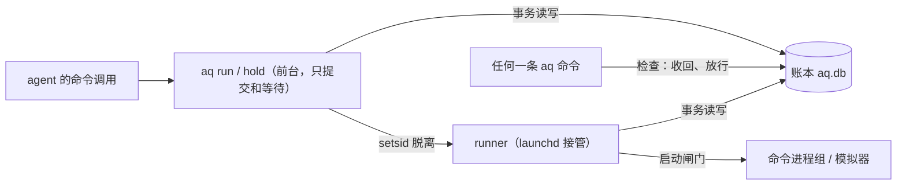
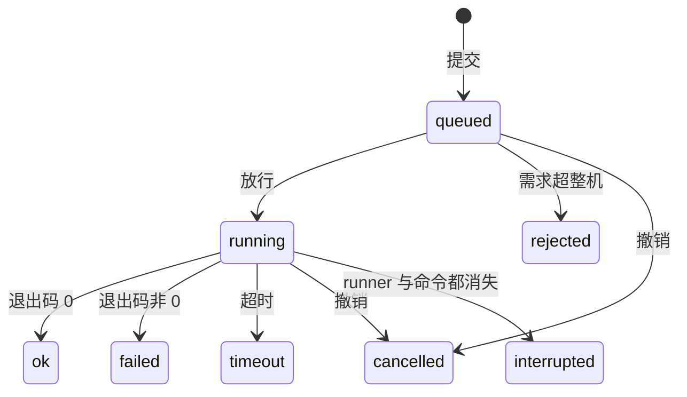
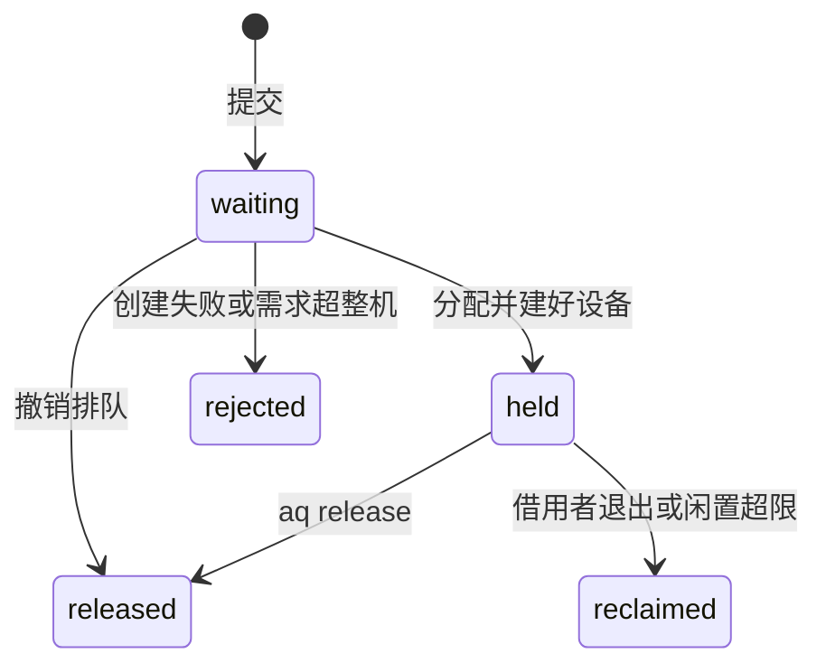

# aq 技术方案

状态：v1，已实现。用例表见 [cases.md](cases.md)，文中 `CASE-*` 指向其中的行。

## 目录

1. [概述](#1-概述)
2. [术语](#2-术语)
3. [架构](#3-架构)
4. [核心流程](#4-核心流程)
5. [关键机制](#5-关键机制)
6. [接口](#6-接口)
7. [数据存储](#7-数据存储)
8. [故障与排查](#8-故障与排查)
9. [测试与验收](#9-测试与验收)
10. [设计取舍](#10-设计取舍)
11. [已知局限与后续](#11-已知局限与后续)

## 1 概述

aq 是单机上多个 AI agent 共用的排队与借还工具：agent 把编译、测试交给 `aq run`，把模拟器、真机、测试账号的使用交给 `aq hold` / `aq release`。aq 没有常驻服务，所有 aq 进程通过一个 SQLite 账本协作。

```bash
aq run -- xcodebuild -scheme App -destination 'generic/platform=iOS Simulator' build
# → {"id":"ex_7f3a","status":"queued","reused":false,"retry_after_s":120}
aq status ex_7f3a --wait 100
# → {"id":"ex_7f3a","status":"ok","reused":false,"log":"~/.local/state/aq/logs/ex_7f3a.log"}
```

### 1.1 解决的问题

| 问题 | aq 的做法 |
| --- | --- |
| 多个 agent 同时编译，内存换页、机器卡死 | 按内存、磁盘余量放行，重任务同时最多 N 个（默认 2） |
| 多个 agent 抢同一台模拟器、真机或测试账号 | 设备和账号一次只借给一组；模拟器每次新建、归还即删；借用者退出或闲置就收回 |
| 同一份代码上的同一条命令被重复执行 | 进行中的执行直接共用，结果共享 |
| agent 写循环轮询结果 | 一条命令等结果，超时先返回状态，再查一次接着等 |

### 1.2 范围

| aq 负责 | aq 不负责 |
| --- | --- |
| 估算每个任务要多少资源 | 任务怎么编译、怎么测试（项目脚本） |
| 记账：谁占着什么、还剩多少、何时收回 | 编译产物和缓存的复用（构建工具） |
| 排队与放行 | 多步流程的顺序（agent 逐步调用） |
| 合并进行中的重复执行 | 在设备上操作 App（agent-device 等工具） |
| 全局状态查看 | 多台机器之间的调度 |

aq 按需使用：只调度经它提交的任务，不拦截其他命令。

### 1.3 约束

| 约束 | 原因 |
| --- | --- |
| 只在一台 macOS 上运行 | 进程探测用 libproc，模拟器用 simctl |
| 不引入常驻后台服务 | 后台服务挂掉会卡住所有人，且要维护安装和升级 |
| 不写任何项目的特例 | 接入新项目、新命令不改 aq |
| 不碰项目的缓存、不改仓库内容 | 避免破坏增量编译 |
| 不凭进程号单独判断进程存活，不按占用时长强行收回在用的设备 | 进程号会被重用；占得久不代表不用 |
| agent 的命令可能随时被打断，重复执行必须安全 | agent 的命令行工具有调用超时 |
| 绕过 aq 的占用也要算进去 | 机器不只 aq 在用 |

### 1.4 不变量

1. 运行中任务的内存、磁盘记账之和不超过容量；运行中的重任务不超过名额。
2. 一台设备、一个测试账号同一时刻只属于一组借用。
3. 内容和命令都相同的请求同一时刻只真正执行一次；内容或命令不同的绝不合并。
4. 借用者退出后，它占的资源会被自动收回。
5. 只要资源最终够用，排队的请求一定能轮到。
6. 报告的状态是真实的：没做完、失败、被中断的不会报成功。

## 2 术语

| 词 | 意思 |
| --- | --- |
| 执行（execution） | 一次 `aq run` 提交的命令，id 以 `ex_` 开头 |
| 借用（hold） | 一次 `aq hold` 借到的一组设备和账号，整组借、整组还，id 以 `hd_` 开头 |
| runner | 每个执行、每个借用各有一个的后台进程，负责排队、执行或创建设备、写结果；是 aq 自己（`aq __runner <id>`） |
| 账本 | `$XDG_STATE_HOME/aq/aq.db`，记录所有执行、借用和资源评估 |
| 重任务 | 平均占 ≥ 2 核的任务，如全量编译；同时运行的个数受名额限制 |
| 内容指纹 | 表示「当前代码」的字符串：工作区干净时是 commit SHA，有改动时是 `SHA+dirty.<摘要>` |
| 任务 hash | 由内容指纹、仓库内相对执行目录、命令原文算出；相同即「同一件事」 |
| 命令签名 | 去掉绝对路径、临时目录、设备 id、长数字后的命令；签名相同的命令共用一份资源评估 |
| 资源评估 | 一类命令要多少内存、磁盘、是否重任务、多久；来自实测、AI 评估缓存或首次见到 |
| 借用者 | 借设备的 agent 会话主进程；它退出即收回借用 |
| 已验证 agent | aq 内置表里的 agent（Claude Code、Codex）：能用它的命令行工具做资源评估，能按它的进程认借用者 |
| worktree | 同一 git 仓库的另一个工作目录；agent 通常各用一个 |

## 3 架构

### 3.1 进程模型



- 前台命令只提交和等待，被打断不影响后台；runner 脱离 agent 的进程树，任务照常完成（CASE-RUN-5）。
- runner 是命令的父进程，命令退出就写结果。runner 启动时拿住自己的文件锁，进程退出时系统自动释放；「拿得到它的锁」即「runner 已不在」。
- 每条 aq 命令都会先做一次「检查」（4.6）：兜底丢失的结果、收回借用、放行排队者。没有后台服务也能推进状态。

### 3.2 代码分层

一个 Cargo workspace，依赖方向由编译器检查：

```
┌────────────────────── aq（可执行文件，src/）──────────────────────┐
│ cli：解析参数 → 调用例 → 输出 JSON 或 --human 文本，映射退出码       │
│ app：run / status / cancel / hold / release / runner 的用例编排     │
│      固定节奏：开事务 → 读快照 → core 算出动作 → 执行动作 → 提交      │
└──────┬──────────────────────┬──────────────────────────┬──────────┘
       ▼                      ▼                          ▼
┌─ aq-store ───────┐  ┌─ aq-core（纯逻辑）────────┐  ┌─ aq-sys（外部世界）──────────┐
│ 建表、迁移、事务、 │  │ 状态机、放行、估算、       │  │ git 指纹、进程组、进程探测、   │
│ 查询              │  │ hash 与签名、收回判定、    │  │ 脱离会话、文件锁、系统资源、   │
│                   │  │ ports（外部能力的 trait）  │  │ simctl、emulator、AI 命令行  │
└───────────────────┘  └───────────────────────────┘  └──────────────────────────────┘
        aq-store、aq-sys 只依赖 aq-core；aq-core 不依赖任何 IO
```

- aq-core 不读文件、不看时间、不起进程。检查就是 `plan(快照, 当前时间, 探测结果) → 动作列表`，同样输入永远得到同样输出。
- ports 用 trait 描述 8 种外部能力：时钟、git、进程、系统资源、模拟器、真机探测、AI 命令行、文件锁。aq-sys 提供真件，测试提供假件。

### 3.3 依赖

| 用途 | 选用 | 说明 |
| --- | --- | --- |
| 命令行 | clap | `--` 之后的参数原样透传 |
| SQLite | rusqlite（bundled）、rusqlite_migration | 自带 SQLite，不受系统版本影响；迁移基于 `user_version` |
| JSON、配置 | serde、serde_json、toml | `deny_unknown_fields` 严格解析 |
| 目录 | etcetera | 按 XDG 取目录 |
| id、哈希 | ulid、blake3 | — |
| 进程 | libc（只在 aq-sys） | setsid、killpg、proc_pidinfo、sysctl(KERN_PROCARGS2) |
| 识别调用方 agent | is-ai-agent | 按环境变量识别 agent 类型 |
| 系统指标 | libc（sysctl、host_statistics64、libproc） | 内存压力与可用百分比、换出页数、磁盘、进程 RSS、物理内存占用与启动时间 |
| 带超时等子进程 | wait-timeout | AI 评估限时 |
| 文件锁 | 标准库 `File::try_lock` | runner 锁 |
| git、模拟器 | 调用 `git`、`xcrun simctl`、`xcrun devicectl`、`emulator`、`adb` | 没有覆盖子模块递归 diff 和模拟器管理的库 |
| 错误 | thiserror（库内）、anyhow（main） | — |

## 4 核心流程

### 4.1 aq run

```text
1. 解析参数：没有 -- 或命令为空 → rejected usage
2. 定位：当前目录 → worktree 根 → 仓库
3. 算内容指纹和 hash（只读，30 秒超时；失败或不在 git 里 → hash 为空，不复用）
4. 事务：检查 → 有同 hash 在排队或运行且未带 --fresh → 挂上，reused=true
              否则插入一条 queued 的执行，启动它的 runner
5. 等待：读库直到结束或到 --wait → 输出一行 JSON
```

### 4.2 run 的 runner

```text
a. 启动：拿住自己的文件锁；做进程组组长，记下组号和启动时间
b. 评估资源（5.2）；需求超过整机容量 → rejected unschedulable，退出
c. 排队：周期性检查；轮到自己 → running；看到撤销请求 → cancelled
d. 执行：命令在自己的进程组里跑，输出写 logs/<id>.log；采样内存和 CPU，核对超时和撤销
   终止时先 SIGTERM 整个进程组，宽限 10 秒后 SIGKILL
e. 结束：重算指纹得出 content_changed；写结果和实测；做一次放行；退出
```

### 4.3 aq hold 及其 runner

```text
1. 校验：至少一台设备、设备类型存在 → 否则 rejected usage
   真机台数超过清单，或所需内存超过整机 → rejected unschedulable
   借真机时探测一次：登记且此刻可用的不够 → rejected device_unavailable
   登记了但此刻不可用的记进请求的 exclude，分配时跳过
2. 定位借用者（5.5）
3. 事务：检查 → 插入一条 waiting 的借用，启动它的 runner
4. runner 排队；轮到时在同一事务里分配真机、写入账号、为模拟器预留内存（仍为 waiting）
   提交后创建并启动模拟器、实例或会话，回填设备 id → held
   创建失败 → 整组回滚、全部释放 → rejected device_error
   runner 到此退出；之后借用是否有效，只看借用者和闲置情况
5. 前台按 --wait 等待；借到后创建 holds/<id>.used 作为闲置计时起点
```

### 4.4 aq release 与 aq cancel

```text
release：held    → released；删账号行和真机行（立即可借）；模拟器行保留，启动后台删除
         waiting → released（等于撤销排队）
         已结束   → 原样返回
         后台删完模拟器、实例或会话后删设备行，它占的内存才释放；删除 holds/<id>.used

cancel： queued  → cancelled（runner 看到后退出）
         running → 置撤销请求，runner 终止进程组后写 cancelled
         已结束   → 原样返回
```

### 4.5 aq status

```text
不带 id：检查 → 第一行全机概况 → 之后每行是全机所有排队、运行中的执行和未归还的借用
带 id  ：逐个查；带 --wait 时直到全部结束或超时；id 不存在 → rejected usage；退出码取最大
```

### 4.6 检查

所有命令共用，在一个数据库事务里完成：

```text
1. 结果兜底（只针对 runner 意外消失的执行）
   runner 不在、命令进程也不在 → interrupted，释放资源
   runner 不在、命令进程还在   → 继续计占用，等它结束
   排队中的 runner 不在        → 重新拉起，保持排队位置
2. 借用：借用者已退出 → reclaimed；闲置超限 → reclaimed
   被收回的设备交给后台删除；定期按名字对账，删掉本账本里没有对应活动借用的残留（别的账本的设备不动）
3. 放行：排队的执行和借用按先后一起过一遍，资源够就放行（5.3）
```

### 4.7 用法示例

```bash
# 同时提交两个任务，再一起等
aq run --wait 0 -- xcodebuild build -scheme SettingsModule -destination 'generic/platform=iOS Simulator'
aq run --wait 0 -- swift test --filter ToolTests
aq status ex_7f42 ex_7f43 --wait 100

# 借一台模拟器和一个账号做验证，用完归还
aq hold ios-sim --account alice
# → {"id":"hd_19c2","status":"held","devices":[{"type":"ios-sim","id":"ABADBEDA-…"}],"accounts":["alice"]}
xcrun simctl install ABADBEDA-… App.app && xcrun simctl launch ABADBEDA-… com.example.app
aq release hd_19c2
```

| 场景 | 写法 |
| --- | --- |
| 单设备多账号 | `aq hold ios-sim --account alice --account bob` |
| 多设备多账号 | `aq hold ios-sim ios-sim --account alice --account bob` |
| 多设备同一账号 | `aq hold ios-sim ios-device --account alice` |
| 需要模拟器的测试 | 先 `aq hold ios-sim`，再把借到的 id 写进 `-destination 'id=…'` |

## 5 关键机制

### 5.1 复用与内容指纹

同一份代码、同一执行目录、同一条命令已有一次在排队或运行时，再提交直接共用那一次（CASE-REUSE-1）。

- hash = H(内容指纹, 执行目录在仓库内的相对路径, 命令原文)。命令按原文计算，不做归一；环境变量不进 hash。
- 内容指纹覆盖未提交改动、未被 .gitignore 忽略的新文件、子模块（递归）；被忽略的文件不算。工作区干净时直接用 SHA。只读计算：所有 git 调用带 `GIT_OPTIONAL_LOCKS=0`，不拿 `.git/index.lock`（CASE-REUSE-6）。
- 跨 worktree 也复用；结果里带实际执行的 worktree，产物只在那里。
- 只合并进行中的：已结束的不复用；`--fresh` 和不在 git 仓库里的执行 hash 为空，不参与合并（CASE-REUSE-4）。
- 运行中代码又变了：结束时重算指纹，变了就标 `content_changed`（CASE-REUSE-5）。

| 情况 | hash | 用例 |
| --- | --- | --- |
| 有未提交改动、有未忽略的新文件、子模块有改动 | 与干净时不同 | CASE-REUSE-2 |
| 两边改动逐字节相同；改了又改回；只改被忽略的文件 | 相同 | CASE-REUSE-2 |
| 内容相同但 SHA 不同（如 rebase 后） | 不同 | CASE-REUSE-2 |
| 执行目录不同、命令原文不同（含参数顺序、会话临时路径） | 不同 | CASE-REUSE-3 |
| 只有环境变量不同 | 相同；需要区分时加 `--fresh` | CASE-REUSE-3 |

### 5.2 资源评估

项目和 agent 都不用告诉 aq 一条命令要多少资源，aq 按「仓库 + 命令签名」自己估。

**命令签名**：去掉每次都变的部分（绝对路径、临时目录、设备 id、长数字）。被执行的程序或脚本是绝对路径时保留文件名，只换掉目录；跳过开头的 `env` 和 `KEY=VALUE`；解释器（sh、bash、python 等）后面的第一个非选项参数也算程序（CASE-EST-7）。

**取值顺序**：

| 来源 | 什么时候用 | 怎么算 |
| --- | --- | --- |
| 实测 | 同仓库同签名有至少 1 次实测 | 取最近 20 次，第 k 新的权重 0.8^k。内存：1 次时峰值 × 1.2，多次时加权 p90 × 1.1；磁盘同理；时长取加权中位数；多数执行平均 ≥ 2 核记为重任务。中断、撤销、耗时不到中位数 10% 的记录不参与时长估计，内存峰值照样计入（CASE-EST-5、CASE-EST-11） |
| AI 评估缓存 | 还没有实测，但同类命令之前已有 AI 评估（如同类命令第一次还在跑时又提交了一次） | 见下文；内存不超过全机实测峰值 p90（CASE-EST-14） |
| 首次见到 | 既没有实测也没有 AI 评估缓存 | 不等 AI，立即按轻任务放行：内存、磁盘、时长取全机实测中位数，没有历史时内存 1G；不占下载名额；超时 2 小时。判轻实重由运行中纠正兜住，跑完一次就有实测（CASE-EST-2、CASE-EST-13） |

超时一律限制在 30 分钟到 2 小时之间。

首次见到为什么不等 AI：AI 只看命令签名和仓库规模，实测常把峰值百 MB 的命令估成 6–12G；同步评估要 7–74 秒，高负载时这份偏高的估计再让一条 3 秒的测试排队 100 秒（agent-verify 2026-11-17 实测）。按轻任务先放行、运行中纠正，代价是首次的重命令最多 10 秒内多占一个重任务名额。实测在每次执行结束时写入执行记录，下一次放行就用新数据。

**AI 评估**（不在放行路径上：首次见到的命令放行后，runner 在后台线程里评估一次并缓存，runner 退出前等它写完）：

- 用谁的命令行工具：按环境变量认出调用方 agent（is-ai-agent），在已验证 agent 表里查到就用它的非交互模式；查不到不调 AI。配置了 `ai_cli` 时以配置为准。

  | agent | 会话主进程 argv[0] | 评估命令 |
  | --- | --- | --- |
  | Claude Code | `claude` | `claude -p --tools "" --strict-mcp-config --no-session-persistence --output-format text` |
  | Codex | `codex` | `codex exec --sandbox read-only --skip-git-repo-check -` |

  新 agent 进表前，要确认它的评估命令确实读写不了文件。
- 输入：命令签名、执行目录、仓库按扩展名统计的文件数量和大小、本机内存容量与重任务名额。仓库统计由 aq 算好写进提示词。
- 隔离：在空临时目录里运行，关掉全部工具和 MCP，提示词走标准输入；命令原文里夹带的指令无法让 AI 读写文件（CASE-EST-6）。
- 输出校验：取输出末尾的 JSON 对象（前面允许有说明文字），字段必须正好是 `heavy`、`mem_gb`、`disk_gb`、`net`、`est_minutes`、`reason`；内存不超过整机、耗时不超过 2 小时；不合格按失败处理。低于下限（256MB、1 秒）的抬到下限。
- 限时 60 秒；同签名并发请求只评估一次；失败不写缓存，2 分钟内同签名不再调，之后再试（CASE-EST-3）。
- 一旦有实测，AI 评估不再用于放行。执行记下的用量只算命令本身，不含 AI 命令行和 git 的开销（CASE-EST-8）。

**运行中纠正**：按轻任务放行的执行，runner 每 0.5 秒采样进程组成员及其所有后代（另开进程组的子进程也算，如 xcodebuild 的编译服务）的累计 CPU 时间；运行满 10 秒且最近 10 秒平均 ≥ 2 核，就改记为重任务、占一个名额，不中止，只升不降。因此运行中的重任务最多暂时超出名额 1 个（CASE-EST-10）。采样漏掉两次采样之间退出的进程，测到的是偏低的下界，只会少纠正，不会误判。

运行中实际内存超过估计时不中止，由放行时的「实际余量」挡住后续任务（CASE-EST-12）。

### 5.3 排队与放行

执行和借用排在同一个队里，按提交先后处理（CASE-QUEUE-1～4）：

1. 先来先服务，资源够就放行。
2. 排头放不下时，它缺的那类资源只留给它；后面的可以先用它不缺的资源。例如排头的编译在等重任务名额，借模拟器的请求可以先拿到设备，另一个重任务不能插队。
3. 因此等待有上限：排到第一后，最晚在当前运行任务的最长超时内开始。借设备没有超时。

放行要同时满足：重任务名额、下载名额、内存、磁盘底线。内存和磁盘取账面余量和实际余量中较小的一个；实际余量要减去运行中任务「已记账但还没用到」的部分，否则刚启动、内存还在上涨的任务会被忽略：

```
可放行_r = min( C_r − Σ a_i,r ,  F_r − floor_r − Σ max(0, a_i,r − u_i,r) )
```

C 是配置的容量，a 是各任务记账量，u 是当前实际用量，F 是系统实际可用量，floor 是保留底线。

**内存怎么量、什么时候不放行、模拟器最多几台**（CASE-QUEUE-5～7、CASE-HOLD-12）。起因：agent-verify 2026-11-17 实测，内存占用已 85% 时 aq 一次放出 3 台新模拟器，峰值同时 7 台、占用 94%，机器明显变慢（一行 python 约 50 秒），而当时 memory_pressure 报的空闲最低 29%、压力仍为正常——慢主要来自 3 台同时冷启动抢 CPU 和磁盘，不是内存用尽。

| 项 | 做法 | 理由 | 代价 |
| --- | --- | --- | --- |
| 容量 C | 没配置时取物理内存的 3/4（36G → 27G）；配置了以配置为准 | 原先写死 28G，16G、64G 的机器都不对 | 3/4 是假设，验证见下 |
| 实际可用 F | 内核给 jetsam 用的空闲百分比 `kern.memorystatus_level` × 物理内存 | 与 `memory_pressure` 报的同一个数，人和 aq 看同一个读数 | 和以前的 sysinfo 读数不同，`mem_pct` 会变 |
| 压力闸门 | `kern.memorystatus_vm_pressure_level` 为 warn、critical，或距上次采样换出超过 64MB（只比 2 分钟内的上一次读数，读数存在状态目录的 `vm-swapouts`）时，要内存的一律不放行，`waiting_for` 报 `mem_pressure` | 余量公式只看数量，换页已经发生时还会继续放；压力等级是系统自己的判断 | 别的程序造成的压力也会挡住 aq 的任务；64MB 是假设 |
| 冷启动串行 | iOS 模拟器、Android 实例同一时间只建一台，其余 waiting，`waiting_for` 报 `cold_start` | 3 台同时冷启动是 RT-3-2 卡顿的主因，agent-device 也会因此 3/3 失败 | 连借 3 台时最后一台多等前两台的启动时间（每台约 30 秒） |
| 模拟器台数上限 | 同时存在的 iOS 模拟器加 Android 实例（含还在建、已归还还没删完的）不超过 `sim_slots`；没配置时物理内存每 8G 一台，至少 1 台（36G → 4、16G → 2、64G → 8）。浏览器会话不算。到上限的借用 waiting，`waiting_for` 报 `sim_slots`；一次就要超过上限的 rejected | 每台模拟器实际占多少内存量不准（按进程树加 phys_footprint 单台得 7.8–12G，单台启动时系统空闲只降约 1%），按台数管比按内存记账可靠；批 2 同时 4 台、占用 80% 人没感觉卡，批 3 到 7 台、94% 明显变慢；3 台合计约占 14G，即每台约 4.5G | 每 8G 一台是假设：在 16G、64G 的机器上各连借到上限，看压力是否进 warn、人是否感到卡；只数本账本的设备，别的账本和用户自己开的模拟器不算 |
| 压力等待上限 | 被内存压力挡住时继续排队，不失败；返回里带 `mem_pressure_s`（已持续多久，开始时刻记在状态目录 `mem-pressure-since`，压力回落即删）；超过 10 分钟再加 `message`，说明压力来自 aq 以外的程序、关掉占内存的程序后会自动开始 | 失败返回会让 agent 重试或放弃，排队 + 说清原因对人打扰最少；压力是机器层面的，aq 无法替人解决 | 一直不回落时任务会一直排着；10 分钟是假设 |

假设怎么验证：在本机用真 simctl 连借 3 台、再连借 4 + 1 台，记录每次放行时的压力等级、空闲百分比、换出增量和同时在建的台数，与改前的 0.3.0 对比（证据在 agent-verify 测试目录 `a3/`）；之后按真实负载回放（CASE-LOAD-1）时压力不进 warn。

### 5.4 设备与账号

一组借用里可以有多台设备和多个账号，整组借到或整组等待，不占其中任何一项（CASE-HOLD-4）。账号可以登在组内任一设备上，怎么登由 agent 决定。

| 设备类型 | 来源 | 借出规则 | 归还时 |
| --- | --- | --- | --- |
| `ios-sim` | 借时按配置机型新建并启动，名为 `aq-<账本标识>-<借用id>-<序号>`，系统用支持该机型的最新运行时 | 按内存余量供给 | 关机并删除，连同它的 CoreSimulator 日志目录（CASE-HOLD-1、CASE-RECLAIM-6） |
| `android-emu` | 借时按配置的 AVD 用只读、无窗口方式新起实例，端口 5600–5680，设备 id 为 `emulator-<端口>` | 按内存余量供给；AVD 必须是 aq 专用的 | kill 实例（CASE-HOLD-2） |
| `browser` | 借时开一个 agent-browser 会话 | 可多个 agent 同时借，按内存供给 | 关闭会话（CASE-HOLD-3） |
| `desktop` | 发一个 agent-desktop 会话名 | 可多个 agent 同时借 | 无需清理 |
| `ios-device` | 配置里登记的 UDID | 一台只借给一组；只借登记且此刻可用的 | 立即可再借；aq 不清理真机上的 App 和数据 |
| `android-device` | 配置里登记的序列号 | 同上（可用 = adb 状态为 device） | 同上 |

真机可用性（CASE-DEV-1～4）：iOS 要已配对、开发者模式已开、有线或同网无线可达；判定在提交时做一次。登记的都不可用时立即拒绝并附每台的原因，不排队。已连接但没登记的真机绝不借出，拒绝结果列出它们，并给出可粘贴进配置的片段。只借模拟器时不探测真机。

账号不需要配置，借用时写的名字就是账号。aq 只保证同一个名字同时只在一组借用里，不存密码、不检查有效性（CASE-HOLD-5）。

### 5.5 自动回收

```text
任意 aq 命令 ──► 检查 ──┬─ 借用者已退出？ ──► 整组收回
                       ├─ 闲置超过阈值？  ──► 整组收回
                       └─ 再判定哪些排队的可以放行
```

| 策略 | 做法 |
| --- | --- |
| 借用者退出就收回 | 借用时按环境变量认出 agent，沿父进程链找到它的会话主进程（已验证 agent 表里的 argv[0]），记下进程号和启动时间；检查时两者都对得上才算还在（CASE-RECLAIM-3） |
| 闲置超限收回 | 使用设备的工具每次操作时更新 `holds/<借用id>.used` 的修改时间；超过阈值（默认 2 小时）没更新就收回。收回后使用方发现文件不在，得知已收回（CASE-RECLAIM-4） |
| 认不出借用者 | 借用者记为未识别（进程号 0），只按闲置收回。不拿直接调用方顶替：它多半是每条命令临时起的 shell，命令结束就退出（CASE-RECLAIM-5） |
| 归还提醒（可选） | `scripts/stop-hook.sh` 装成 Claude Code 的 Stop hook 后，借着设备闲置 5 分钟结束回答时提醒一次 `aq release`，不拦截（CASE-RECLAIM-8） |

release 和自动收回同时触发时只有一个生效，设备只删一次（CASE-RECLAIM-7）。

### 5.6 进程与崩溃安全

| 机制 | 做法 |
| --- | --- |
| runner 脱离会话 | 前台 fork 出子进程，子进程 setsid 后再拉起 runner 并立刻退出，runner 由 launchd 接管；标准输入接 /dev/null，继承的文件描述符全部关闭（CASE-RUN-5） |
| 启动闸门 | runner 建管道后 fork 出命令进程，命令进程做进程组组长后阻塞读管道；runner 在事务里写入 running、组号和启动时间并提交后，才写 1 个字节放行。提交前崩溃：命令从未执行，重新拉起安全；提交后放行前崩溃：命令未执行，记为 interrupted（CASE-FAULT-4） |
| 进程存活 | 文件锁证明 runner 在；进程号 + 启动时间判断命令和借用者是否还在 |
| 残留清理 | aq 创建的模拟器、实例、会话都叫 `aq-<账本标识>-<借用id>-<序号>`，账本标识是状态目录真实路径的 blake3 前 8 位。对账时只删带本账本标识、又没有对应活动借用的，用户自己开的、别的账本（开发、演示、测试用另一个 `XDG_STATE_HOME` 的 aq）的都不动；不带标识的旧格式名字只由默认账本（`~/.local/state/aq`）认领；Android 实例在本账本没有名字记录时不动。借用的 runner 被重新拉起时先删本借用的半成品（CASE-FAULT-2、CASE-FAULT-5、CASE-HOLD-9、CASE-HOLD-10） |
| 超时 | 预计时长 × 3，限制在 30 分钟到 2 小时；只算机器醒着的时间（`CLOCK_UPTIME_RAW`），`*_at` 时间点仍记真实时间（CASE-RUN-6、CASE-RUN-7） |
| 嵌套 run | runner 给命令设置 `AQ_EXECUTION_ID`；内层 `aq run` 发现它就直接执行、不排队，资源算在外层（CASE-RUN-8） |
| 日志上限 | 单个日志超过 200MB 就清空并写一行提示，命令继续（CASE-RUN-9） |
| 数据库事务 | 写操作用 `BEGIN IMMEDIATE`；进程中途被杀，事务自动回滚（CASE-FAULT-6） |

## 6 接口

### 6.1 命令

```text
aq run     [--fresh] [--wait <秒>] [--human] -- <命令> [参数...]
aq status  [<id>...] [--wait <秒>] [--human]
aq status  --top
aq cancel  <执行id>
aq hold    <设备类型>... [--account <账号名>]... [--wait <秒>] [--human]
aq release <借用id>
```

| 子命令 | 做什么 |
| --- | --- |
| `run` | 提交一条命令，最多等 `--wait` 秒（默认 100，不设上限）；`--wait 0` 只提交不等 |
| `status` | 不带 id 列出全机；带 id 查这些对象，加 `--wait` 等到全部结束或超时；`--top` 全屏仪表盘 |
| `cancel` | 撤销排队中或运行中的执行 |
| `hold` | 借一组设备和账号；设备至少一台，要几台写几次；账号可以没有 |
| `release` | 整组归还 |

- `--` 后面的命令原样执行，不经过 shell；需要管道、`&&` 时写成 `-- sh -c '…'`（CASE-RUN-3）。
- 在哪个目录调用，就在哪个目录执行。
- aq 不检查命令里用了哪台设备；只用借到的设备 id 是 agent 的约定，写在 `skills/aq/SKILL.md`。
- `--human` 输出给人看的文本：执行所在目录、内容指纹、队位、在等什么、评估来源、借用者、状态目录（CASE-STATUS-4）。
- `--top` 是给人旁观和演示用的英文仪表盘：CPU、内存、磁盘占用条和重任务名额条，每个活动的执行、借用一行；终端里每 0.5 秒原地重画，输出不是终端时只画一帧。只读，用手写的 ANSI 控制码，不引入终端界面库（CASE-STATUS-6）。

### 6.2 输出

每个对象一行 JSON。字段只在适用时出现；新增字段或枚举值算接口变更（CASE-STATUS-3）。

**执行对象**（run、status）

| 字段 | 出现时机 | 用途 |
| --- | --- | --- |
| `id` | 总是 | 传给 status、cancel |
| `status` | 总是 | 决定下一步 |
| `reused` | 只在 `aq run` 的返回里 | 这次提交是否接上了别人的同一次执行；status、cancel 不输出（它们没有「这次提交」可言） |
| `mem_pressure_s` `message` | 在等内存压力回落 | 压力已持续的秒数；超过 10 分钟另加 `message` 说明，仍在排队（CASE-QUEUE-5） |
| `waiting_for` | queued、waiting 且查得到原因 | 在等哪类资源：`heavy`、`mem`、`mem_pressure`、`cold_start`、`sim_slots`、`disk`、`net`、`device:<类型>`、`account:<名字>`（CASE-QUEUE-5、CASE-QUEUE-6） |
| `retry_after_s` | queued、running | 建议多少秒后再查，10–300，只是轮询建议 |
| `exit_code` | failed | 命令退出码 |
| `log` | 命令已开始运行 | 输出日志路径 |
| `content_changed` | 已结束且为 true | 结果对应的不是最新代码 |
| `reason` `message` | rejected | 原因枚举和一句说明 |

| status | 含义 | 退出码 |
| --- | --- | --- |
| `queued` / `running` | 在等资源 / 正在执行 | 2 |
| `ok` | 命令退出码为 0 | 0 |
| `failed` | 命令退出码非 0 | 1 |
| `timeout` | 超时被终止 | 1 |
| `interrupted` | 意外中断（进程被杀、机器重启） | 1 |
| `cancelled` | 被撤销 | 1 |
| `rejected` | 没有执行就被拒绝 | 3 |

**借用对象**（hold、release、status）

| 字段 | 出现时机 | 用途 |
| --- | --- | --- |
| `id`、`status` | 总是 | — |
| `devices` | held | 借到的设备，顺序与请求一致，每项 `{"type","id"}` |
| `accounts` | held 且借了账号 | 借到的账号名 |
| `missing` | held 且按 id 查询时有设备已不存在 | 已不存在的设备 id（被 aq 以外删掉、模拟器服务被重置）；借用状态不变，调用方自己决定归还重借（CASE-HOLD-11） |
| `retry_after_s` | waiting | 同执行对象 |
| `reason` `message` | rejected | 同执行对象 |
| `unavailable` | rejected device_unavailable | 登记了但此刻不可用的真机，每项 `{type,id,name,why}` |
| `undeclared` `config_snippet` | rejected 且有已连接但没登记的真机 | 这些设备，以及可整段替换进配置的片段 |

| status | 含义 | 退出码 |
| --- | --- | --- |
| `waiting` | 排队等资源 | 2 |
| `held` | 已借到 | 0 |
| `released` | 已归还 | 0 |
| `reclaimed` | 被自动收回 | 0 |
| `rejected` | 没有借出就被拒绝 | 3 |

cancel、release 的退出码只表示请求是否被接受：接受即 0。status 带多个 id 时退出码取最大（CASE-STATUS-2）。

| reason | 含义 |
| --- | --- |
| `usage` | 写法不对：缺 `--`、hold 没写设备、设备类型不存在、id 不存在、配置文件写错（消息带行号）（CASE-RUN-2、CASE-STATUS-5） |
| `unschedulable` | 需求超过整机容量，永远满足不了（CASE-EST-9、CASE-HOLD-6） |
| `device_error` | 设备创建或启动失败；整组已回滚，可重新 hold（CASE-HOLD-7） |
| `device_unavailable` | 登记且此刻可用的真机不够；立即拒绝，不排队（CASE-DEV-2） |

另有两种错误退出码为 1：等数据库写锁超过 5 秒（`reason` 为 `busy`，数据未改，稍后重试，CASE-FAULT-9）；状态目录不可写或被沙箱拦截（只有消息，写明路径，CASE-FAULT-7）。

**全机概况**（`aq status` 不带 id 时的第一行，CASE-STATUS-1）

```json
{"running":2,"queued":1,"cpu_pct":85,"mem_pct":70,"disk_pct":58,"phone_pct":100,"sims":2}
```

| 字段 | 含义 |
| --- | --- |
| `running` `queued` | 运行中、排队中的执行数 |
| `cpu_pct` | 整机 CPU 使用率：两次读整机 CPU 时间计数，取非空闲占比；单次查询间隔 0.2 秒，`--top` 取相邻两帧之间。不用平均负载，它把等磁盘的线程也算进去 |
| `mem_pct` | 已占内存占 aq 内存容量的比例（取记账值和实际值中较大者） |
| `disk_pct` | 磁盘已用比例 |
| `phone_pct` | 真机借出比例 |
| `sims` | 借出的模拟器台数 |

### 6.3 配置

`${XDG_CONFIG_HOME:-~/.config}/aq/config.toml`，可选；不存在时用内置默认值。严格解析：未知字段、类型不对时所有命令返回 rejected usage 并带行号。

```toml
heavy_slots = 2          # 同时最多几个重任务
mem = "28G"              # aq 可分配的内存；不写时取物理内存的 3/4
disk_floor = "50G"       # 磁盘至少保留这么多
net_slots = 3            # 同时下载的任务数
sim_slots = 4            # iOS 模拟器加 Android 实例最多几台；不写时物理内存每 8G 一台
ai_cli = "auto"          # auto：按已验证 agent 表；也可写死一条命令

[ios-sim]
model = "iPhone 17 Pro"  # 新建用的机型
mem = "3G"               # 每台记账内存

[android-emu]
avd = "Pixel_8_API_35"   # aq 专用的 AVD
mem = "4G"

[browser]
mem = "1G"

[ios-device]
ids = ["00008150-…"]     # 只借这里登记的真机；agent 不改这一段

[android-device]
ids = []
```

除 `ids` 外，上面就是内置默认值；`ids` 默认为空。

## 7 数据存储

### 7.1 目录

```
${XDG_STATE_HOME:-~/.local/state}/aq/
├── aq.db                  账本，SQLite，WAL 模式
├── locks/<id>.lock        runner 持有的文件锁；ai-<签名>.lock / .failed 是 AI 评估的互斥与失败标记
├── holds/<借用id>.used    修改时间 = 最近一次使用
├── logs/<执行id>.log      命令的 stdout + stderr
├── runner.err             runner 和清理进程自己的 stderr
└── aq.log                 aq 自身的状态转移与诊断日志，每行一个 JSON，超过 50MB 滚动
```

- 锁和账本必须在同一个目录：macOS 默认不设 `$XDG_RUNTIME_DIR`，分开放时各会话环境不一致会把 runner 误判为已消失。
- 同一用户的所有 agent 必须解析出同一个状态目录；`aq status --human` 显示正在用的目录（CASE-STATUS-4）。
- 账本被删时下一条命令重建空库（CASE-FAULT-7）。

### 7.2 表设计规范

| 规范 | 做法 |
| --- | --- |
| 类型 | 表用 STRICT 模式 |
| 命名与单位 | 小写加下划线；单位写进字段名（`_mb`、`_s`、`_cores`）；时间点一律 `*_at`，存 Unix 毫秒 |
| 主键 | `ex_`、`hd_` 加按时间有序的 ULID |
| 枚举与布尔 | 枚举用 TEXT + CHECK；布尔用 INTEGER + `CHECK(x IN (0,1))` |
| 可空 | 默认 NOT NULL；只在某些状态下才有值的字段可空，并用 CHECK 与状态绑定 |
| 终态不可改 | 触发器拒绝修改终态记录的 status；状态倒退由 aq-store 里带原状态条件的更新函数挡住（CASE-STORE-3） |
| JSON | 只在 `argv`、`request` 两处，加 `CHECK(json_valid(...))` |
| 连接设置 | 每个连接 `busy_timeout = 5000`、`foreign_keys = ON`；建库时 `journal_mode = WAL`、`synchronous = NORMAL` |
| 版本 | `PRAGMA user_version`；结构变更只做加法，迁移文件写下后不再修改（CASE-STORE-6） |
| 单一来源 | 建表语句只写在 `crates/aq-store/migrations/`；`docs/schema.sql` 是副本，有测试比对 |

### 7.3 表

**executions**：一行一次执行。

| 字段 | 约束 | 用途 |
| --- | --- | --- |
| `id` | 主键 | — |
| `hash` | 可空 | 找可复用的执行；`--fresh` 或算不出指纹时为空 |
| `status` | 枚举 | queued / running / ok / failed / timeout / interrupted / cancelled / rejected |
| `cwd`、`argv` | `argv` 为 JSON 数组 | runner 在此执行 |
| `profile_key` | — | 查同类命令的评估和实测 |
| `fingerprint` | 可空 | 结束时与重算值比较 |
| `content_changed` | 0/1，仅终态 | — |
| `heavy` `mem_mb` `disk_mb` `uses_net` | 评估后才有 | 放行记账；`uses_net` = 1 占一个下载名额 |
| `timeout_s` | 评估后才有 | 判断超时 |
| `submitted_at` `started_at` `finished_at` | 按状态才有 | 排队顺序、耗时 |
| `pgid` `pgid_started_at` | running 时必有 | runner 不在时判断命令是否还在 |
| `cancel_requested` | 0/1 | runner 看到后终止命令 |
| `exit_code` | 仅 ok / failed | — |
| `peak_mem_mb` `cpu_avg_cores` `disk_delta_mb` | 仅终态 | 下一次资源评估 |

**profiles**：AI 评估缓存，主键 `profile_key`，另有 `signature`、`heavy`、`mem_mb`、`disk_mb`、`uses_net`、`est_s`、`ai_output`。只缓存成功的评估。

**holds**：一行一组借用。

| 字段 | 约束 | 用途 |
| --- | --- | --- |
| `id` | 主键 | — |
| `status` | 枚举 | waiting / held / released / reclaimed / rejected |
| `request` | JSON | 分配依据，如 `{"devices":["ios-sim"],"accounts":["alice"]}` |
| `owner_pid` `owner_started_at` | — | 借用者；未识别时为 0，不做退出检查 |
| `requested_at` `acquired_at` `ended_at` | 按状态才有 | 排队顺序、借用时长 |

**hold_devices**（`hold_id`、`seq`、`type`、`device`）：一行一台借出的设备；创建中 `device` 为空，用来预留内存。**hold_accounts**（`account` 主键、`hold_id`）：一行一个借出的账号。

### 7.4 索引与约束

```sql
-- 同一 hash 最多一个进行中的执行
CREATE UNIQUE INDEX one_inflight ON executions(hash) WHERE status IN ('queued','running');
-- 一台设备同时只借给一组（创建中 device 为空，不参与）
CREATE UNIQUE INDEX one_device_holder ON hold_devices(device);
-- 一个账号同时只在一组：hold_accounts.account 是主键
CREATE INDEX exec_queue   ON executions(status, submitted_at);
CREATE INDEX exec_profile ON executions(profile_key, finished_at);
CREATE INDEX hold_queue   ON holds(status, requested_at);
```

列出进行中的执行分两次等值查询（先 `running` 再 `queued`），不写 `status IN (...)`：后者在这张索引上会全表扫描。放行与估算用完整索引而不是部分索引：SQLite 不会把 `status='queued'` 匹配到部分索引条件上（CASE-STORE-4）。

### 7.5 状态变化





排队中的 runner 意外消失时重新拉起，保持排队位置；借用的 runner 先删本借用的半成品再重拉。进入终态后不再变化；只有终态执行的实测参与资源估计。

### 7.6 保留

已结束的执行、已结束的借用各保留最近 5000 条（设备行、账号行级联删除）；日志总量超过 2G 时删最旧的已结束任务日志。进行中的不删（CASE-STORE-5）。

## 8 故障与排查

### 8.1 出问题时的表现

| 情况 | aq 的处理 |
| --- | --- |
| agent 的命令超时、会话被关 | 任务继续跑完；用 id 执行 `aq status` 接着等，不要了用 `aq cancel` |
| 任务卡住不退出 | 超时后先 SIGTERM，10 秒后 SIGKILL，记为 timeout |
| 只有 runner 被杀 | 命令还在就继续占资源，结束后记为 interrupted |
| runner 和命令都被杀、机器重启 | 下一次检查记为 interrupted、借用 reclaimed，资源释放，残留设备清理 |
| 借设备的 agent 退出 | 下一次检查整组收回，模拟器删除 |
| aq 自己崩了 | 数据库事务回滚，锁由系统释放，不需要人工清理 |
| 多个进程同时写库 | 等写锁最多 5 秒；超时返回 busy，数据不变（CASE-FAULT-8、CASE-FAULT-9） |

### 8.2 排查

先跑 `aq status --human`：第一行是正在用的配置文件和状态目录，之后每个执行和借用都有在等什么、runner 在不在、进程组在不在、评估来自哪里。

| 现象 | 查什么 |
| --- | --- |
| 任务一直 queued | `--human` 的「在等」；`SELECT status, heavy, mem_mb, disk_mb, uses_net FROM executions WHERE status='running'`；`heavy` 为空说明在等 AI 评估，最多 60 秒 |
| 运行中重任务超过名额 | 正常：轻任务被改记为重任务，`grep 改记重任务 aq.log` |
| 卡在 running | `--human` 看进程组是否还在；`ps -g <pgid>` |
| 变成 interrupted | `grep <id> aq.log` 看原因；`runner.err` 看 runner 为什么退出 |
| 借用一直 waiting | `SELECT * FROM hold_devices; SELECT * FROM hold_accounts;` 看谁占着；模拟器按内存放，看 `mem_pct` |
| 借用被 reclaimed | `grep <id> aq.log` 的原因：借用者已退出或闲置超限；`owner_pid` 是借用者 |
| 返回 busy | `lsof aq.db` 找长时间持有写锁的进程 |
| 没有复用 | 比较两次的 `fingerprint`、`cwd`、`argv`；`--fresh` 和不在 git 里 hash 为空 |

`aq.log` 每次状态转移一行：`ts`、`id`、`from`、`to`、`reason`、`by`（触发命令），以及 `note`（评估来源、重拉 runner、删除设备、改记重任务等）。

## 9 测试与验收

### 9.1 测试分层

| 层 | 测什么 | 放在哪 | 修改规则 |
| --- | --- | --- | --- |
| 单元 | aq-core 的纯规则：状态转移、放行、估算、签名、超时、真机判定 | 各模块的 `#[cfg(test)]`，或 `<模块>/tests.rs` | 随意改 |
| 集成 | 按 aq 命令黑盒测试，外部工具用假件 | `tests/acceptance/<功能>.rs`；存储约束在 `tests/storage/` | 可以新增；修改或删除已有断言要和实现分开提交，并交给人确认 |
| 契约 | 同一 port 的真件和假件行为一致 | `tests/contracts/`，一个宏同时生成两份测试 | 真件和假件都要通过 |
| 迁移夹具 | 每个旧版本的库都能升级 | `tests/storage/fixtures/vN/` | 写下后不能改 |
| 实机 | 真实 agent 会话、真模拟器、真机 | 人工演练，按用例表里验证为「实机」的行 | 发版前做 |

`just check` 跑全部：格式、clippy（`-D warnings`）、单元、契约、存储、集成、红区检查（`scripts/guard.sh`）、文件大小、用例表核对。长回放用 `just m3`，真 simctl 建删一台用 `just drill-sim`。

### 9.2 用例表

[cases.md](cases.md) 是需求定义的行为清单，一行一条，按领域分节。守某条用例的测试在 `#[test]` 上方注释写编号（如 `// CASE-RUN-1`）；不守需求行为的集成测试标 `// 表外：<原因>`。`scripts/check-cases.py` 核对：

1. 验证列写了「单元」的用例，至少有一个 `crates/`、`src/` 里的测试标了它；
2. 写了「集成」的，至少有一个 `tests/` 里的测试标了它；
3. 代码里出现的每个编号都在表里；
4. `tests/acceptance`、`tests/storage` 里每个测试都标了编号或「表外」。

改行为时先改用例表，再改测试和实现。

### 9.3 测试注入

集成测试通过环境变量换掉外部工具和时间阈值，只在测试和排查时使用：

| 变量 | 作用 | 正式值 |
| --- | --- | --- |
| `AQ_SIMCTL` / `AQ_DEVICECTL` / `AQ_EMULATOR` / `AQ_ADB` / `AQ_AGENT_BROWSER` | 换成 `tests/support/` 下的假脚本 | 系统工具 |
| `AQ_SYS_OVERRIDE` | JSON 文件，覆盖物理内存、可用内存、剩余磁盘、CPU、内存压力（`pressure`：normal/warn/critical）、换出（`swapping`） | 不设 |
| `AQ_T_PRESSURE_WARN_S` | 内存压力挡住多久后加说明 | 600 |
| `AQ_T_POLL_MS` | 读库、检查的间隔上限 | 1000 |
| `AQ_T_IDLE_RECLAIM_S` | 闲置多久收回 | 7200 |
| `AQ_T_TIMEOUT_MIN_S` / `AQ_T_TIMEOUT_MAX_S` | 超时上下限 | 1800 / 7200 |
| `AQ_T_KILL_GRACE_MS` | SIGTERM 后多久 SIGKILL | 10000 |
| `AQ_T_AI_TIMEOUT_S` | AI 评估时限 | 60 |
| `AQ_T_SIMGC_S` | 残留设备对账间隔 | 600 |
| `AQ_T_LOG_CAP_MB` / `AQ_T_LOG_TOTAL_MB` | 单个日志 / 日志总量上限 | 200 / 2048 |
| `AQ_T_KEEP` | 已结束执行、借用各保留多少条 | 5000 |
| `AQ_T_HEAVY_WINDOW_S` | 运行中纠正的观察窗口 | 10 |
| `AQ_T_AI_BLOCKING` | 设为 1 时首次见到的命令先同步等 AI 评估（验收支架默认开，用假 AI 的输出设定首次资源；CASE-EST-13 关掉验正式行为） | 不设 |
| `AQ_TEST_CRASH_AT` | `before_commit` / `after_commit`：runner 在启动闸门两侧异常退出 | 不设 |
| `AQ_T_AGENT_ARGV0` | 把已验证 agent 表里的会话主进程名换成假进程名 | 不设 |

## 10 设计取舍

三个原则：崩溃安全靠操作系统和数据库事务，不靠约定；只依赖能观测的事实，不依赖不准的预估；贴合现有工作方式，agent 不必先 commit、也不必改构建位置。

| 决策 | 考虑过的做法 | 选定 | 原因 |
| --- | --- | --- | --- |
| 架构 | 只限总并发（make jobserver）；常驻队列（pueue）；集群调度器（Slurm、Nomad）；自建后台服务；无后台 + 共享账本 | 无后台 + 共享账本 | 只限并发不区分资源和设备；pueue 只有分组并发；集群调度器太重且面向 Linux；后台服务是单点 |
| 判断进程存活 | 进程号；心跳；只用文件锁；文件锁 + 进程号和启动时间 | 最后一种 | 进程号会重用；心跳本质是按时长判断，卡顿时误判；只用文件锁时，命令拉起的长驻进程可能把锁带走 |
| 资源怎么算 | 只看声明；只看实时余量；声明 + 实测校准 + 实时兜底 | 最后一种 | 只看声明，写少或有外部占用就过载；只看实时余量，任务刚启动时内存还没涨，会一下放进太多 |
| CPU | 按核数严格限制；不管；限制重任务个数 | 限制重任务个数（默认 2） | 回放真实负载：一次只编一个平均等待多约 23%；4 个同时编则互相拖慢 |
| 排队顺序 | 先来先服务；短任务优先；响应比优先 + 回填；公平分配 | 先来先服务 + 排头保留 | 回放中更复杂的算法在真实和 4 倍负载下都没有收益；耗时预估只有约一半落在 2 倍误差内 |
| 复用范围 | 复用已完成的产物；只合并进行中的；不复用 | 只合并进行中的 | 复用已完成产物的机会小，还要管理沙盒和清理；不复用会把同一件事并发跑多遍 |
| 判断「同一件事」 | 只看 commit SHA；要求先 commit；内容指纹 + 命令 | 内容指纹 + 命令 | 约一半的编译发生在有未提交改动时，只看 SHA 会把改前改后当成一样 |
| 在哪里执行 | aq 管理的独立目录；调用方自己的 worktree | 调用方 worktree | 独立目录会让增量编译变成冷编译 |
| 设备分配 | 按单次任务借；借还制；接入外部工具（如 Simlock） | 借还制 | 验证是长时间、多命令的交互；外部工具不支持真机和 Android，且和资源记账分离 |
| 等结果的方式 | 一直等；提交就返回、自己轮询；等到上限先返回、再查接着等 | 最后一种 | 一直等会被 agent 的调用超时打断；自己轮询会产生大量空转 |
| 谁给出资源需求 | 项目写配置；agent 每次传参；aq 自己评估 | aq 自己评估 | 配置要人维护、容易过时；agent 传参各写各的；AI 评估只在第一次付出十几秒，之后由实测接管 |
| 识别 agent | 只按进程名；只按环境变量；环境变量认类型 + 已验证表找会话主进程 | 最后一种 | 进程名会被改写（如 Claude Code 的进程名是版本号）；环境变量只说明类型，说明不了会话何时结束 |
| 拦截绕过 aq 的命令 | hook 拦截；不拦截 | 不拦截 | aq 按需使用；绕过的占用由放行时的实际余量兜住 |
| 内置 AI 排序 | 排队复杂时请 AI 排序；不做 | 不做 | 回放中有人排队的时间占比很低，收益接近零 |

## 11 已知局限与后续

### 11.1 已知局限

| 局限 | 影响 | 缓解 |
| --- | --- | --- |
| 重任务名额、磁盘底线默认值固定（2 个、50G） | 核数少的机器可能过载 | 在配置里按本机改；内存容量已按物理内存推出 |
| 只有 Claude Code、Codex 在已验证表里 | 其他 agent 的命令没有 AI 评估缓存，第一次执行按首次见到放行；借用者认不出时只按闲置收回 | 配置 `ai_cli`；新 agent 验证后进表 |
| 用 setsid 脱离进程组的子进程 | 命令结束时不等它；它的父进程退出后用量统计不到（CASE-RUN-10） | — |
| 嵌套的 agent（一个 agent 启动另一个） | 环境变量同时带两种 agent 的标记，可能认成外层 agent | — |
| 新建并启动一台 iOS 模拟器约需 30 秒 | 借模拟器有固定开销 | 需要时再做预热副本 |
| 只支持一台 Mac | 不做多机调度 | — |

### 11.2 后续

| 事项 | 什么时候做 |
| --- | --- |
| 撤销、归还别人的对象需要 `--force`，默认只取消自己的订阅 | 出现一次「任务被别人撤了」 |
| 有人排队时，闲置 15 分钟的借用提前收回；收回前宽限，操作设备前核对归属 | 出现设备长期借不到 |
| 排队复杂时请 AI 给出顺序 | 排队时间占比明显上升，或 agent 数量翻倍 |
| 事件表；`--human` 显示卡在哪类资源 | 出现一次靠日志查不出原因的卡住 |
| runner 世代号、孤儿命令接管 | 实测出现 busy 报错或卡死 |
| 每类命令保留最少实测、账本损坏重建、敏感信息脱敏 | 对应问题出现 |
| 模拟器按实测内存记账（先要找到可信的量法） | 台数上限在不同内存的机器上不够用 |
| 重任务名额按本机核数自动算出 | 对外分发前 |
